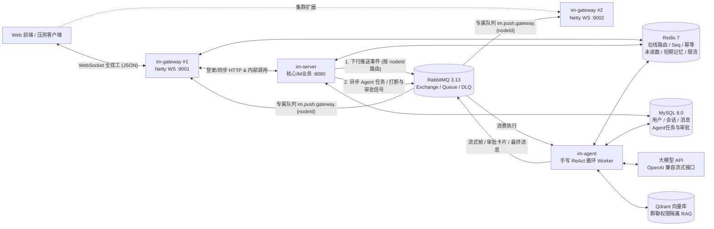
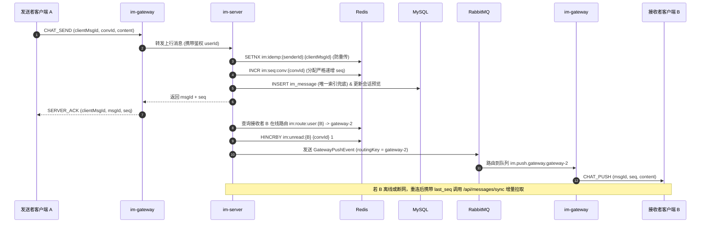
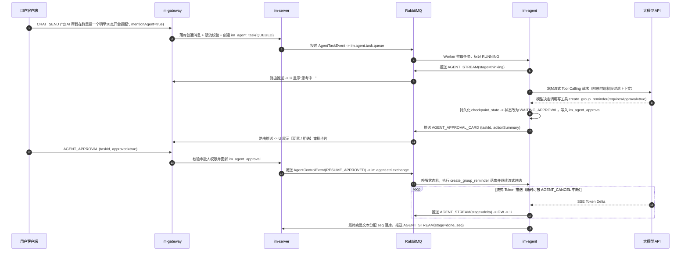

# WebSocket 即时聊天 + AI Agent 系统设计文档

> **项目定位**：面向 Java 后端实习的高含金量工程项目——以**高并发可靠 IM 底座**展示传统后端硬实力，以**异步解耦、全双工流式打断与人机协同审批的 AI Agent 引擎**形成差异化竞争力。
>
> **核心技术栈**：JDK 21 · Spring Boot 3.3 · Netty 4 · MySQL 8.0 · MyBatis-Plus · Redis 7 · RabbitMQ 3.13 · Qdrant（阶段 3 可选）

---

## 1. 系统核心亮点（对标实习简历与面试深挖点）

1. **消息不丢、不重、严格有序**：客户端生成幂等 `clientMsgId` + 服务端基于会话的单调递增 `seq` + `SERVER_ACK` 确认 + 断线重连基于 `last_seq` 的推拉结合增量同步。
2. **网关与业务/算力彻底解耦**：`im-gateway`（Netty）专注维持海量 TCP/WebSocket 长连接；普通业务走 `im-server`；长耗时、高 I/O 等待的 LLM 推理与工具调用通过 RabbitMQ 异步交给独立的 `im-agent` Worker，绝不阻塞 IM 主链路。
3. **分布式集群跨节点路由**：Redis 维护 `userId -> gatewayNodeId` 在线路由映射；每个网关节点订阅专属 RabbitMQ 推送队列，实现多网关实例间的精准跨机消息推送。
4. **WebSocket 全双工 AI Agent 交互**：
   * 阶段化流式协议（`thinking` → `tool_call` → `delta` → `done`/`aborted`）+ **实时中途打断（Cancel）**；
   * **多租户/会话级权限隔离 RAG**：检索群聊历史记忆时强制注入 `conversation_id` 与成员权限过滤；
   * **人机协同审批（Human-in-the-Loop）**：执行写操作工具（如创建群提醒/发布公告）前挂起状态机、推送确认卡片，用户点击确认后再唤醒恢复执行；
   * **生产级治理**：普通消息与 `@Agent` 差异化限流（并发 + Token 配额）、工具步数熔断（`max_steps`）与全链路指标记录（TTFT 首字延迟、总耗时、Token 消耗）。

---

## 2. 系统总体架构与核心链路

### 2.1 分层与模块架构图



### 2.2 模块职责划分（单仓库多模块 Maven）

| 模块 | 默认端口 | 职责定位 | 重点技术 / 面试考点 |
| :--- | :---: | :--- | :--- |
| **`im-common`** | - | 公共协议帧、Payload DTO、MQ 事件模型、Redis Key 常量、统一返回体、JWT 签发与验签工具 | 协议抽象、常量治理、模块边界解耦 |
| **`im-gateway`** | `9001` (WS)<br/>`8081` (管理) | Netty WebSocket 服务端、握手 JWT 鉴权、读空闲心跳剔除、本地 `Channel` 会话表、注册 Redis 在线路由、消费本节点 MQ 推送队列 | NIO/Epoll、Reactor 主从线程模型、零拷贝、`IdleStateHandler`、优雅停机 |
| **`im-server`** | `8080` | 用户注册/登录、会话与群成员管理、消息幂等落库、`seq` 分配、推拉结合离线增量同步、未读数维护、跨节点推送分发、Agent 任务投递与审批回调 | 联合索引与回表、消息可靠性三要素、写扩散/读扩散权衡、缓存一致性 |
| **`im-agent`** | `8082` | 消费异步 Agent 任务、手写轻量 ReAct 循环、WebClient 流式解析与实时打断（`Disposable`/`Cancel`）、带权限隔离的 Tool Calling、状态机挂起与恢复、TTFT/Token 统计 | 算力异步解耦、全双工取消控制、Human-in-the-Loop 状态机、限流与熔断 |

### 2.3 核心时序图一：消息可靠投递与跨节点推送



### 2.4 核心时序图二：AI Agent 流式输出、打断与人机审批闭环



---

## 3. WebSocket 统一通信协议规范

### 3.1 连接建立与心跳机制
* **握手地址**：`ws://{gatewayHost}:9001/ws?token={jwtToken}`
* **鉴权时机**：在 Netty `WebSocketServerProtocolHandler` 完成握手前（HTTP Upgrade 阶段）解析 `token` 并校验签名与有效期，失败直接返回 `401 Unauthorized` 拒绝建连，避免非法连接占用内存。
* **心跳保活**：客户端每 **25 秒** 发送一次 `PING`，服务端回复 `PONG`；网关侧配置 Netty `IdleStateHandler(readerIdleTime = 60s)`，超过 60 秒未收到任何上行帧则主动关闭连接并清理 Redis 路由。

### 3.2 统一包络格式（JSON）

```json
{
  "type": "CHAT_SEND",
  "requestId": "req-20261124-0001",
  "timestamp": 1795453713000,
  "data": {}
}
```

### 3.3 上行帧定义（Client → Gateway）

| `type` | 用途 | `data` 核心字段示例 |
| :--- | :--- | :--- |
| `PING` | 心跳探测 | `{}` |
| `CHAT_SEND` | 发送单聊/群聊/`@Agent` 消息 | `{"conversationId":1001,"clientMsgId":"c-uuid-1","msgType":"TEXT","content":"你好","mentionAgent":false,"replyToMsgId":null}` |
| `MSG_ACK` | 客户端确认消费/已读上报 | `{"conversationId":1001,"seq":42}` |
| `AGENT_CANCEL` | 实时打断正在生成的 Agent 任务 | `{"taskId":90001,"conversationId":1001}` |
| `AGENT_APPROVAL` | 人机协同审批回调 | `{"taskId":90001,"approvalId":80001,"approved":true,"comment":"确认发布"}` |

### 3.4 下行帧定义（Gateway → Client）

| `type` | 用途 | `data` 核心字段示例 |
| :--- | :--- | :--- |
| `PONG` | 心跳响应 | `{}` |
| `SERVER_ACK` | 服务端已持久化回执 | `{"clientMsgId":"c-uuid-1","msgId":50001,"conversationId":1001,"seq":43}` |
| `CHAT_PUSH` | 实时消息推送 | `{"msgId":50001,"conversationId":1001,"senderId":2001,"senderNickname":"Alice","seq":43,"msgType":"TEXT","content":"你好","createdAt":1795453713100}` |
| `AGENT_STREAM` | Agent 全双工流式状态/增量帧 | `{"taskId":90001,"conversationId":1001,"stage":"delta","delta":"好的，已为你","toolName":null,"msgId":null,"seq":null}` |
| `AGENT_APPROVAL_CARD` | 写操作人机确认卡片 | `{"taskId":90001,"approvalId":80001,"conversationId":1001,"actionName":"create_group_reminder","summary":"创建群提醒：明早10:00周会","expireAt":1795454013000}` |
| `ERROR` | 统一错误帧 | `{"code":4001,"message":"消息发送过于频繁，请稍后再试","requestId":"req-20261124-0001"}` |

---

## 4. Redis Key 与 RabbitMQ 拓扑设计规范

### 4.1 Redis Key 规范（统一维护在 `RedisKeys.java`）

| Key 模板 | 数据结构 | TTL | 用途与一致性说明 |
| :--- | :---: | :---: | :--- |
| `im:route:user:{userId}` | String / Hash | 90s（心跳续期） | 存储用户当前连接的 `gatewayNodeId`；断连时比对 `channelId` 再删，防顶号误删新连接 |
| `im:seq:conv:{convId}` | String (`INCR`) | 永久（缓存失效从 DB `MAX(seq)` 重建） | 高并发分配会话内严格递增 `seq` |
| `im:idemp:{senderId}:{clientMsgId}` | String (`SETNX`) | 10 min | 弱网客户端重传去重，命中直接返回已落库的 `msgId + seq` |
| `im:unread:{userId}` | Hash (`convId -> count`) | 30 天 | 会话未读红点计数，上报已读时重置对应 field |
| `im:agent:ctx:{convId}` | List | 24 小时 | Agent 短期滑动窗口记忆（最近 $N$ 轮对话，按 Token 预算裁剪） |
| `im:agent:stream:{taskId}` | String (`APPEND`) | 30 min | 暂存流式输出已生成文本，客户端中途刷新或断线重连可恢复进度 |
| `im:agent:cancel:{taskId}` | String | 10 min | 打断标志位，配合 MQ 广播双重保障及时中止 LLM 请求 |
| `im:rl:chat:{userId}` | String / ZSet | 窗口 TTL | 普通消息发送限流（如 20 条/10 秒） |
| `im:rl:agent:{userId}` | String | 1 天 | Agent 每日调用次数 / Token 预算配额控制 |

### 4.2 RabbitMQ Exchange / Queue 拓扑（统一维护在 `MqConstants.java`）

| Exchange | 类型 | Queue | RoutingKey | 作用 |
| :--- | :---: | :--- | :--- | :--- |
| `im.push.exchange` | `direct` | `im.push.gateway.{nodeId}` | `{nodeId}` | 精准将下行消息/流式帧投递给目标用户所在网关节点 |
| `im.agent.exchange` | `direct` | `im.agent.task.queue` | `agent.task` | IM 业务服务向 Agent Worker 异步投递任务，削峰解耦 |
| `im.agent.dlx` | `direct` | `im.agent.task.dlq` | `agent.task.dead` | 死信队列：承接多次重试失败的异常 Agent 任务，防止阻塞正常队列 |
| `im.agent.ctrl.exchange` | `fanout` | 每个 Worker 匿名/独立队列 | `""` | 广播 `CANCEL` 打断与 `APPROVAL` 唤醒信号，瞬间命中正在执行该任务的 Worker |

---

## 5. 6～8 周稳扎稳打开发计划与面试八股对照

> **原则**：前 4 周结束后即产出一个可写进简历的扎实的分布式 IM 底座；第 5～6 周注入核心 AI Agent 差异化亮点；第 7～8 周跑压测拿真实指标、补齐集群路由和简历 STAR 包装。

### 第 1～2 周｜阶段 1：MVP 闭环（让系统先跑起来）
* **开发任务**：
  1. 在 `im-server` 实现用户注册/登录接口（BCrypt 加密 + `JwtTokenUtil` 签发 Token）、创建单聊/群聊会话与拉取会话列表接口。
  2. 在 `im-gateway` 实现 Netty WebSocket 启动器（`BossGroup`/`WorkerGroup` + `HttpServerCodec` + `HttpObjectAggregator` + 自定义握手 JWT 鉴权 Handler + `WebSocketServerProtocolHandler` + `IdleStateHandler` + 业务 Handler）。
  3. 跑通单机单聊/群聊实时收发与 MySQL 持久化，生成一套极简前端联调页面验证双开浏览器互聊。
* **验收标准**：两个浏览器标签页分别登录不同账号，建连成功、心跳不断、消息实时互达且刷新后能查到历史记录。
* **同步吃透的八股**：BIO/NIO/AIO 与 Epoll 多路复用、Netty Reactor 主从多线程模型、WebSocket 握手升级过程、Spring Boot 自动装配原理。

### 第 3～4 周｜阶段 2：IM 可靠性与高性能底座加固
* **开发任务**：
  1. 接入 Redis `INCR` 会话级 `seq` 分配（含缓存缺失从 DB 恢复的分布式锁保护）与 `SETNX` 幂等去重。
  2. 补齐 `SERVER_ACK` 回执与前端发送状态机（发送中 → 已送达 → 失败重发）。
  3. 实现 `/api/messages/sync?conversationId=x&afterSeq=y&limit=50` 断线重连离线增量拉取，以及 Redis Hash 维护未读数与已读清零。
  4. 引入 RabbitMQ `im.push.exchange`，实现基于 Redis `im:route:user:{userId}` 的跨节点推送路由。
* **验收标准**：模拟弱网重复发送同一 `clientMsgId` 不会产生重复消息；断开连接期间收到的消息在重连后严格按 `seq` 补齐；本地同时启动两个不同端口的 `im-gateway`（`9001`、`9002`），分连两个网关的用户可以正常互发消息。
* **同步吃透的八股**：MySQL B+Tree 联合索引与最左前缀、唯一索引冲突处理、Redis 持久化（RDB/AOF）与缓存一致性、IM 读扩散 vs 写扩散权衡。

### 第 5～6 周｜阶段 3：AI Agent 深度工程融合
* **开发任务**：
  1. 识别 `@AI` 消息，由 `im-server` 校验配额限流后写入 `im_agent_task` 并投递 `im.agent.task.queue`。
  2. 在 `im-agent` 基于 WebClient 手写轻量 **ReAct 调度循环**，对接兼容 OpenAI 协议的流式大模型 API，将 `thinking`/`tool_call`/`delta`/`done` 实时路由回用户所在网关。
  3. 实现 **实时中途打断（`AGENT_CANCEL`）**：通过 `im.agent.ctrl.exchange` + Redis 标记位取消正在进行的 HTTP 流，截断并落库已生成内容。
  4. 实现 2 个高价值 Tool：
     * `search_chat_history`：接入 Qdrant 向量库（或先 MySQL + 后期切 Qdrant），**强制附带 `conversation_id` 权限过滤**防越权检索；
     * `create_group_reminder`：标记 `requiresApproval = true`，触发 **人机协同审批卡片**，挂起状态机至 `WAITING_APPROVAL`，用户点击确认后再唤醒落库并推送结果。
* **验收标准**：群里 `@AI` 总结聊天记录或查历史结论准确且不能跨群越权；生成长回复时点击“停止生成” 200ms 内中止；触发创建群提醒时弹出审批卡片，同意后真实落表并广播通知。
* **同步吃透的八股**：RabbitMQ 交换机类型、死信队列与消息可靠消费（手动 ACK + 幂等）、Reactor/WebFlux 异步非阻塞流与取消传播、状态机持久化设计。

### 第 7～8 周｜阶段 4：治理、压测调优与简历收官
* **开发任务**：
  1. 实现普通聊天与 `@Agent` 的差异化限流（Redis + Lua 令牌桶 / 固定窗口计数）与超时/429 降级兜底。
  2. 记录每次 Agent 任务的 `ttft_ms`（首字延迟）、`total_ms`、Token 消耗，提供一个轻量统计接口。
  3. 编写 WebSocket 并发压测脚本（模拟数千并发长连接 + 持续发消息），使用 VisualVM / Arthas / JFR 观察堆内存、GC、Netty 线程 CPU 占用并记录至少 1～2 轮调优前后的数据对比。
  4. 整理架构图、压测报告、高频面试追问清单与简历 STAR 话术。
* **验收标准**：拿到真实可复现的压测指标（单机稳定连接数、P99 消息延迟、Agent TTFT），对代码中每个组件都能讲清“为什么选它、挂了怎么办”。
